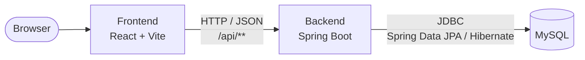
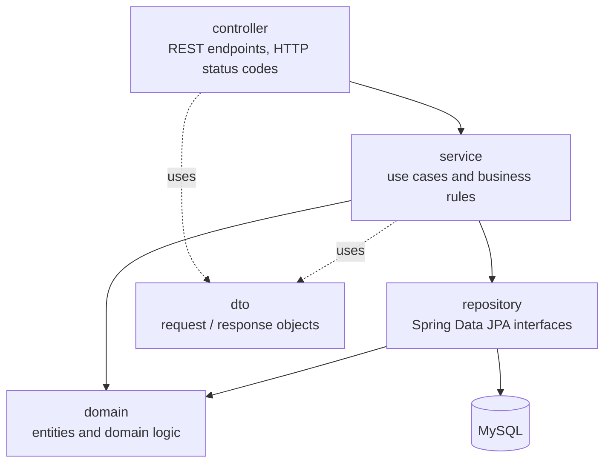

# StudyMatch Software Architecture

This document describes the architecture of StudyMatch. It was proposed in Sprint 1 and
updated in Sprint 2; it is expected to evolve as new requirements are introduced. The design
of the Sprint 2 features (profile rule, cold start, CSV import) is explained in
[sprint-2-design.md](../sprint-2-design.md).

## 1. Overview

StudyMatch is a full-stack web application made of three runtime components:



| Component | Technology | Responsibility |
|---|---|---|
| Frontend | React + Vite (JavaScript) | User interface. Displays data and collects user input. Contains no business rules. |
| Backend | Java 21 + Spring Boot, built with Maven | Exposes the REST API, validates input, applies all business rules and manages persistence. |
| Database | MySQL 8 | Stores students, academic history, competencies and group data between executions. |

The frontend and backend are separate applications in the same repository
(`frontend/` and `backend/`). They only communicate through the REST API, so either
side can change internally without affecting the other.

## 2. Backend architecture

The backend follows a layered architecture. Each layer only depends on the layer
directly below it.



| Package | Responsibility | May depend on |
|---|---|---|
| `controller` | Receives HTTP requests, validates the request format, calls a service and maps the result to an HTTP response. No business logic. | `service`, `dto` |
| `service` | Implements the use cases (e.g. register a student, calculate a profile). Enforces business rules and defines transaction boundaries. | `repository`, `domain`, `dto` |
| `repository` | Data access through Spring Data JPA interfaces. No business logic. | `domain` |
| `domain` | JPA entities and their own rules (e.g. a grade must be between 0 and 20), and the profile calculation: plain Java classes with no Spring or database dependency (`ProfileCalculator`, `AcademicEvidence`, `ColdStartPolicy`, `EvidenceAggregator`). | `exception` |
| `dto` | Objects sent to and received from the frontend. Entities are never returned directly by the API. | — |
| `exception` | Domain exceptions and a global handler that converts them into consistent JSON error responses. | `dto` |
| `demo` | Demo data loaded at startup when `studymatch.demo-data.enabled=true`: one loader per feature, each only adding what is missing. | `domain`, `repository` |
| `config` | Technical configuration, added when needed (e.g. CORS for production). | — |

Root package: `pt.upt.studymatch`.

### Where business rules live

- Rules about a single entity live in the entity itself, so they apply wherever the
  entity is created: for example `AcademicRecord` checks the grade range and that the
  status matches the grade, and `CourseUnitCompetency` checks the weight.
- Rules that need data from the database (e.g. "the student number is unique" or
  "the same attempt cannot be recorded twice") live in the **service** layer.
- The profile calculation lives in plain Java classes in `domain`, with no Spring or
  database dependencies. This keeps the most important logic easy to unit test and easy
  to replace.
- The frontend and the controllers never contain business rules.

### Error handling

Services and entities throw one of three general exceptions: `NotFoundException` (404),
`ConflictException` (409, e.g. `DuplicateStudentException`) and `BusinessRuleException` (400).
A single `@RestControllerAdvice` translates them into HTTP responses with a consistent body,
so new features never need to change the handler:

```json
{ "status": 409, "error": "Conflict", "message": "Student number 51631 already exists" }
```

## 3. Frontend architecture

```
frontend/src/
├── components/          reusable UI parts (forms, tables, layout)
│   └── student/         the sections of the student page
├── pages/               one screen per file, one route each (React Router)
└── services/            one file per feature that calls the backend API, built on http.js
```

| Route | Page |
|---|---|
| `/students` | List of students and form to add one. |
| `/students/:id` | Student page: header, academic history, initial assessment and competency profile. |
| `/students/:id/edit` | Edit a student. |
| `/competencies` | Competencies and the weight with which each course unit develops them. |
| `/import` | Import academic history from a CSV file. |

- Pages compose components and call functions from `services/`.
- Each feature has its own service file (`studentsApi.js`, `recordsApi.js`, `profileApi.js`, ...)
  and its own section component, so features do not edit the same files.
- The student page recalculates the profile whenever the academic history or the initial
  assessment changes.
- During development, Vite proxies `/api/**` to the backend at `http://localhost:8080`,
  so the frontend uses relative URLs and needs no extra CORS configuration.

## 4. Communication between frontend and backend

- REST over HTTP with JSON bodies.
- All endpoints start with `/api` and use plural English nouns, e.g. `/api/students`.
- Standard HTTP verbs and status codes: `GET` reads, `POST` creates (`201 Created`),
  `PUT` updates, `DELETE` removes. Validation errors return `400`, missing
  resources `404`, and conflicts `409`.
- JSON fields use camelCase.

Current endpoints (Sprint 2):

| Method | Path | Description |
|---|---|---|
| `GET` | `/api/health` | Status of the backend and of the database connection. |
| `GET` | `/api/degrees` | Degrees. |
| `GET` | `/api/course-units?degreeId=` | Course units, optionally of one degree, in curricular order. |
| `GET`, `POST` | `/api/students` | List or register students. |
| `GET`, `PUT` | `/api/students/{id}` | Read or update a student. |
| `GET`, `POST` | `/api/students/{id}/academic-records` | A student's academic history, or add an attempt. |
| `PUT`, `DELETE` | `/api/academic-records/{id}` | Change or delete an attempt. |
| `GET` | `/api/competencies` | Competencies. |
| `GET` | `/api/course-unit-competencies?courseUnitId=` | How course units contribute to competencies (weights). |
| `GET`, `PUT` | `/api/students/{id}/assessments` | A student's initial assessments (cold start); `PUT` replaces the whole set. |
| `GET` | `/api/students/{id}/profile` | The student's competency profile, with the evidence behind every score. |
| `POST` | `/api/imports/academic-records` | Import academic history from a CSV file (multipart field `file`). |

## 5. Persistence

- MySQL 8 is the database. The backend accesses it through Spring Data JPA, with
  Hibernate as the JPA implementation.
- Tables and columns use snake_case (e.g. `student_number`).
- The schema is generated from the entities (`spring.jpa.hibernate.ddl-auto=update`).
  Sprint 2 changed existing tables (a student now has a degree), so a database created in
  Sprint 1 must be recreated once (see the README). Before the next schema change, the plan
  is to switch to versioned migrations (Flyway), so schema changes are reviewed in Pull
  Requests and applied to existing databases automatically.
- Database connection settings come from environment variables (`DB_URL`, `DB_USER`,
  `DB_PASSWORD`), which can also be written in a local `backend/.env` file that is never
  committed.
- The student profile is not stored: it is calculated on request from the stored records
  and assessments, so it can never be out of date.

## 6. Testing and quality

| Level | Tooling | What is tested |
|---|---|---|
| Unit tests | JUnit 5, Mockito | Services and domain logic, without Spring or a database. |
| Integration tests | Spring Boot Test, in-memory H2 database | Controllers, repositories and the full request path. |
| Frontend linting | oxlint | Common mistakes and React rules (e.g. rules of hooks) in the frontend code. |
| Coverage | JaCoCo | Test coverage report, generated by every backend build (`backend/target/site/jacoco`). |
| Continuous integration | GitHub Actions | Every push to `main` and every Pull Request that changes the backend or the frontend runs its build: tests for the backend, lint and build for the frontend. |

The automated tests use H2 so `./mvnw test` runs on any machine without installing
MySQL. The running application uses MySQL.

## 7. Main architectural decisions

| Decision | Reason |
|---|---|
| Separate frontend and backend applications | Clear separation of responsibilities, and each side can be developed and tested independently. |
| Layered backend (controller, service, repository, domain) | Widely known structure that keeps business rules in one place, makes them testable and matches the team's Spring Boot experience. |
| DTOs at the API boundary | Database entities can change without breaking the frontend, and sensitive fields are never exposed by accident. |
| Calculations as plain domain classes | The profile and cold-start rules will change between sprints. Isolating them makes them easy to change and to unit test. |
| Profile calculated on request, not stored | It always reflects the latest grades and assessments, and there is no stored copy to keep in sync. |
| Three general exception types | Every feature reports errors the same way without editing the shared handler. |
| One demo-data loader per feature | Each feature owns its demo data, and loaders only add what is missing, so restarting keeps user changes. |
| Configuration through environment variables | The same build runs on every team member's machine and in CI. |

## 8. Expected evolution

- **Sprint 2 (done):** academic history, competencies, student profiles, the cold-start
  strategy and the CSV import were added as new entities and services, following the same
  layers.
- **Later sprints:** group formation will be added as its own service behind a
  `GroupingStrategy` interface, using student profiles as input (see the "Looking ahead"
  section of the Sprint 2 design). Authentication (Spring Security) will be added when user
  roles become a requirement.
