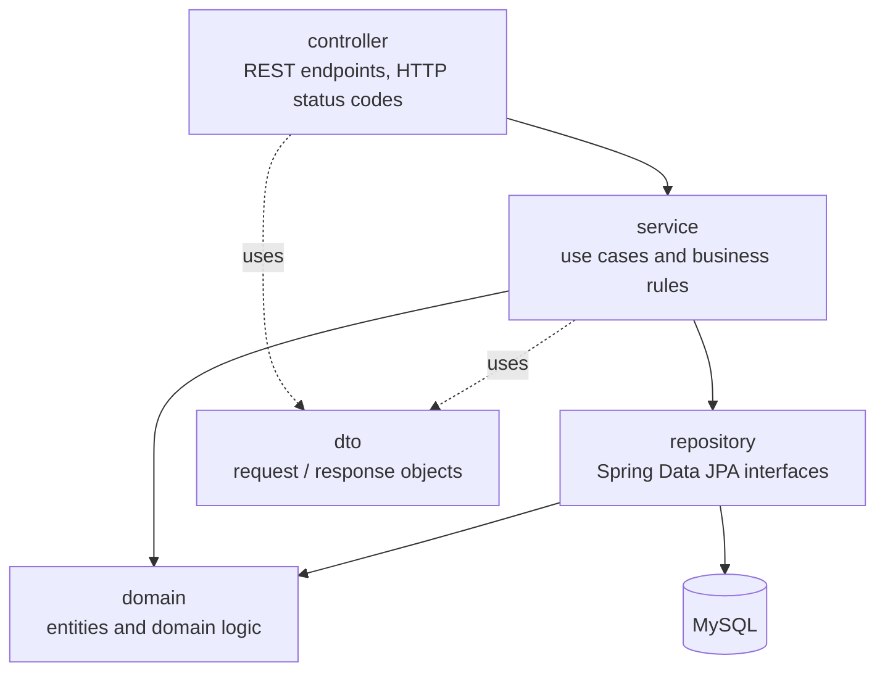

# StudyMatch Software Architecture

This document describes the initial architecture of StudyMatch. It is a proposal
that is expected to evolve as new requirements are introduced in later sprints.

## 1. Overview

StudyMatch is a full-stack web application made of three runtime components:


| Component | Technology | Responsibility |
|---|---|---|
| Frontend | React + Vite (JavaScript) | User interface. Displays data and collects user input. Contains no business rules. |
| Backend | Java 21 + Spring Boot, built with Maven | Exposes the REST API, validates input, applies all business rules and manages persistence. |
| Database | MySQL 8 | Stores students, academic history, competencies and group data between executions. |

The frontend and backend are separate applications in the same repository
(`frontend/` and `backend/`). They only communicate through the REST API, so either
side can change internally without affecting the other.

## 2. Backend architecture

The backend follows a layered architecture. Each layer only depends on the layer
directly below it.



| Package | Responsibility | May depend on |
|---|---|---|
| `controller` | Receives HTTP requests, validates the request format, calls a service and maps the result to an HTTP response. No business logic. | `service`, `dto` |
| `service` | Implements the use cases (e.g. register a student, calculate a profile). Enforces business rules and defines transaction boundaries. | `repository`, `domain`, `dto` |
| `repository` | Data access through Spring Data JPA interfaces. No business logic. | `domain` |
| `domain` | JPA entities and domain logic that does not need the database (e.g. score calculations). | nothing else in the application |
| `dto` | Objects sent to and received from the frontend. Entities are never returned directly by the API. | — |
| `exception` | Domain exceptions and a global handler that converts them into consistent JSON error responses. | `dto` |
| `config` | Technical configuration, added when needed (e.g. CORS for production). | — |

Root package: `pt.upt.studymatch`.

### Where business rules live

- Rules that need data from the database (e.g. "the student number is unique") live
  in the **service** layer.
- Calculations that only need values (e.g. future competency scoring and cold-start
  weighting) live in plain Java classes in the **domain** layer, with no Spring or
  database dependencies. This keeps the most important logic easy to unit test.
- The frontend and the controllers never contain business rules.

### Error handling

Services throw domain exceptions (e.g. `DuplicateStudentException`). A single
`@RestControllerAdvice` translates them into HTTP responses with a consistent body:

```json
{ "status": 409, "error": "Conflict", "message": "Student number 51631 already exists" }
```

## 3. Frontend architecture

```
frontend/src/
├── components/   reusable UI parts (forms, tables, cards)
├── pages/        one screen per file
└── services/     functions that call the backend API (the only place that uses fetch)
```

- Pages compose components and call functions from `services/`.
- Components never call the API directly. This keeps the API contract in one place.
- During development, Vite proxies `/api/**` to the backend at `http://localhost:8080`,
  so the frontend uses relative URLs and needs no extra CORS configuration.

## 4. Communication between frontend and backend

- REST over HTTP with JSON bodies.
- All endpoints start with `/api` and use plural English nouns, e.g. `/api/students`.
- Standard HTTP verbs and status codes: `GET` reads, `POST` creates (`201 Created`),
  `PUT` updates, `DELETE` removes. Validation errors return `400`, missing
  resources `404`, and conflicts `409`.
- JSON fields use camelCase.

Current endpoints (Sprint 1 technical skeleton):

| Method | Path | Description |
|---|---|---|
| `GET` | `/api/health` | Returns the status of the backend and of the database connection. |
| `GET` | `/api/students` | Lists students. |
| `POST` | `/api/students` | Registers a student. |

## 5. Persistence

- MySQL 8 is the database. The backend accesses it through Spring Data JPA, with
  Hibernate as the JPA implementation.
- Tables and columns use snake_case (e.g. `student_number`).
- In Sprint 1 the schema is generated from the entities
  (`spring.jpa.hibernate.ddl-auto=update`). Once the model stabilises, the plan is
  to switch to versioned migrations (Flyway) so schema changes are reviewed in Pull
  Requests like any other code.
- Database connection settings come from environment variables (`DB_URL`,
  `DB_USERNAME`, `DB_PASSWORD`) with local development defaults, so no personal
  credentials are committed.

## 6. Testing and quality

| Level | Tooling | What is tested |
|---|---|---|
| Unit tests | JUnit 5, Mockito | Services and domain logic, without Spring or a database. |
| Integration tests | Spring Boot Test, in-memory H2 database | Controllers, repositories and the full request path. |
| Frontend linting | oxlint | Common mistakes and React rules (e.g. rules of hooks) in the frontend code. |
| Coverage | JaCoCo | Test coverage report, generated by every backend build (`backend/target/site/jacoco`). |
| Continuous integration | GitHub Actions | Every push to `main` and every Pull Request that changes the backend or the frontend runs its build: tests for the backend, lint and build for the frontend. |

The automated tests use H2 so `./mvnw test` runs on any machine without installing
MySQL. The running application uses MySQL.

## 7. Main architectural decisions

| Decision | Reason |
|---|---|
| Separate frontend and backend applications | Clear separation of responsibilities, and each side can be developed and tested independently. |
| Layered backend (controller, service, repository, domain) | Widely known structure that keeps business rules in one place, makes them testable and matches the team's Spring Boot experience. |
| DTOs at the API boundary | Database entities can change without breaking the frontend, and sensitive fields are never exposed by accident. |
| Calculations as plain domain classes | The profile and cold-start rules will change between sprints. Isolating them makes them easy to change and to unit test. |
| Configuration through environment variables | The same build runs on every team member's machine and in CI. |

## 8. Expected evolution

- **Sprint 2:** academic history, competencies, student profiles and the cold-start
  strategy will be added as new entities and services, following the same layers.
- **Later sprints:** group formation will be added as its own service, using student
  profiles as input. Authentication (Spring Security) will be added when user roles
  become a requirement.
