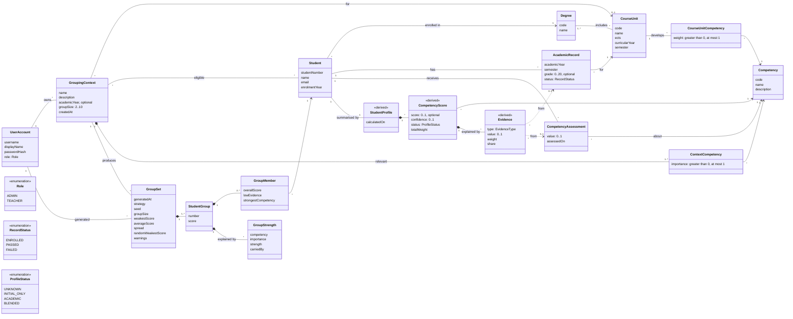

# StudyMatch Domain Model

This model represents the concepts of the StudyMatch problem, as found in the
[use cases](use-cases.md) (UC1–UC16). It describes the domain, not the implementation:
controllers, repositories and database tables are not shown. It was updated in Sprint 2 with
the evidence-based profile, explained in [sprint-2-design.md](sprint-2-design.md), and in
Sprint 3 with accounts, projects and generated groups, explained in
[sprint-3-design.md](sprint-3-design.md).

## Class diagram

## Concepts

| Concept | Use-case term | Use cases | Description |
|---|---|---|---|
| **UserAccount** | Conta, Credenciais | UC1, UC2 | An account that can log in, with a unique username and a password stored only as a hash. Its `Role` defines which features the user can access. Only admins and teachers have accounts; students are managed by them and do not log in. |
| **Role** | Tipo de Conta | UC1, UC2 | `TEACHER` (Professor): registers academic results, assesses new students, defines projects and forms groups. `ADMIN`: also manages accounts, degrees, course units and students. |
| **Student** | Estudante | UC9, UC10, UC12, UC13, UC16 | A student of a degree, identified by a unique student number. Managed by the Admin (UC9). |
| **Degree** | Curso | UC3, UC4, UC9 | A degree programme (e.g. "Engenharia Informática"). |
| **CourseUnit** | Cadeira | UC5, UC6, UC10, UC11 | A course unit of one or more degrees, with its ECTS credits and position in the curriculum. |
| **Competency** | Competência | UC11, UC12 | Something a student can be good at (e.g. Programming, Databases, Problem Solving). Competencies are data, not hard-coded, so new ones can be added (UC11). |
| **CourseUnitCompetency** | Peso da Competência | UC11 | How much a course unit develops a competency (`weight` greater than 0 and at most 1). This is how grades are turned into competencies. A course unit that does not develop a competency has no link to it. |
| **AcademicRecord** | Registo Académico | UC10, UC15 | One attempt of a student at a course unit in a given academic year and semester. A student can have several records for the same course unit (failed and repeated, or grade improvement). The grade is empty while the student is still enrolled. Records can be entered one by one (UC10) or imported (UC15). |
| **CompetencyAssessment** | Avaliação Inicial | UC13 | A teacher's estimate (0 to 1) of a student's level in a competency, for students with little or no academic history (cold start). A student has at most one current assessment per competency. |
| **StudentProfile** *(derived)* | Perfil do Estudante | UC12, UC16 | The current summary of a student: one `CompetencyScore` per competency. It is calculated from academic records and assessments, never entered by hand, so it is always up to date. |
| **CompetencyScore** *(derived)* | Pontuação de Competência | UC12, UC16 | The student's level in one competency (0 to 1), how much evidence supports it (`totalWeight`), how reliable it is (`confidence`) and which kinds of evidence it uses (`status`). With no evidence at all, the score is unknown rather than 0. A low confidence is what "perfil com pouca evidência" means in the search filters. |
| **Evidence** *(derived)* | Evidência | UC12, UC13 | One piece of information about a competency: the best grade of a course unit, or a teacher assessment. It has a value (0 to 1), a weight and its share of the score, which is how the profile explains each number. |
| **GroupingContext** | Projeto (Contexto de Agrupamento) | UC8, UC14 | The situation in which groups are formed, shown to teachers as a "project": its eligible students, the group size chosen by the teacher and, optionally, a course unit and academic year. It belongs to the teacher who created it. |
| **ContextCompetency** | Competência Relevante | UC14 | A competency that matters for a project, with its importance. Groups are balanced on these competencies only. |
| **GroupSet** | Conjunto de Grupos | UC7, UC8 | One generation of groups for a project: when and by whom, with which strategy, seed and group size, and how good the result is (weakest and average group, compared with random groups). Every generation is kept. |
| **StudentGroup** | Grupo | UC7, UC8 | A numbered group within a group set, with its score. |
| **GroupMember** | Membro do Grupo | UC7, UC8 | A student in a group, with what was known about them when the groups were generated (overall score, strongest competency, whether they had no grades yet). |
| **GroupStrength** | Força do Grupo | UC8 | How strong a group was in one relevant competency and which member carries it: the explanation of why the students were grouped together. |

The search use case (UC16, "Pesquisar e Filtrar Estudantes") introduces no new concepts: it
filters existing ones. "Cadeira em que está inscrito" means an `AcademicRecord` with
status `ENROLLED`, and "nível mínimo numa competência" uses `CompetencyScore`.

## Relationships and constraints

1. A student number and an email are unique (UC9). An account username is unique (UC1).
2. A degree code and name are unique (UC3). A course unit code is unique, and a course
   unit belongs to at least one degree (UC5).
3. A student belongs to exactly one existing degree (UC9).
4. A course-unit competency weight is greater than 0 and at most 1. A course unit cannot be
   linked to the same competency twice (UC11).
5. A grade is between 0 and 20. A record with status `PASSED` has a grade of at least 10;
   a record with status `FAILED` has a grade below 10; a record with status `ENROLLED`
   has no grade (UC10).
6. A record's course unit must belong to the student's degree, and a student cannot have
   two records for the same course unit in the same academic year and semester (UC10).
7. An assessment value is between 0 and 1, it is made by a teacher, and a student has at most
   one assessment per competency (UC13).
8. A competency score is calculated only from evidence linked to that competency: the best
   grade of each linked course unit and the teacher assessment. The more academic evidence
   exists, the less the initial assessment counts. Changing a course-unit weight changes the
   calculated profiles (UC11, UC12).
9. A project's group size is between 2 and 10, and the importance of a relevant competency
   is greater than 0 and at most 1. A student can only be chosen once (UC14).
10. Within a group set each eligible student belongs to exactly one group. The number of
    groups is ⌈students / group size⌉ and group sizes differ by at most one; nobody is alone
    in a group. At least 2 eligible students are needed (UC8).
11. A project and its group sets can only be seen, generated and exported by the teacher who
    owns the project, or by an admin (UC7, UC8, UC14).
12. A group set keeps a copy of its explanation, so it does not change when profiles or the
    project change later. A student who is in a group set cannot be deleted (UC8, UC9).

## How the model supports the open problems

- **Academic history:** `AcademicRecord` stores every attempt, so the history shows
  progression, failures and improvements over time.
- **Profiles:** `CourseUnitCompetency` connects grades to competencies, and
  `StudentProfile` is derived from them, which makes it possible to explain which grades
  contributed to each competency.
- **Cold start:** `CompetencyAssessment` gives students without academic history an
  initial profile based on the teacher's observation. `CompetencyScore.confidence` shows
  how much each score can be trusted, and academic evidence gradually takes over as it
  becomes available. The exact formula is a Sprint 2 decision.
- **Matching:** `GroupingContext` and `ContextCompetency` are the input of the
  group-formation algorithm; `GroupSet`, `StudentGroup`, `GroupMember` and `GroupStrength`
  store its result and the explanation shown to the teacher.
