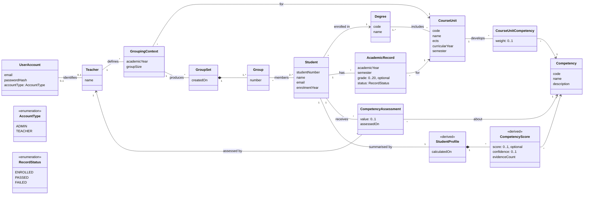

# StudyMatch Domain Model

## Class diagram

## Concepts

| Concept | Use-case term | Use cases | Description |
|---|---|---|---|
| **UserAccount** | Credenciais, Tipo de Conta | UC1, UC2 | Credentials used to log in. Its `AccountType` defines which features the user can access. Only Admins and Teachers have accounts; students are managed by them and do not log in. |
| **Teacher** | Professor | UC7, UC8, UC10–UC14 | Academic staff member who registers academic results, assesses new students, defines grouping contexts and forms groups. |
| **Student** | Estudante | UC9, UC10, UC12, UC13 | A student of a degree, identified by a unique student number. Managed by the Admin (UC9). |
| **Degree** | Curso | UC3, UC4, UC9 | A degree programme (e.g. "Engenharia Informática"). |
| **CourseUnit** | Cadeira | UC5, UC6, UC10, UC11 | A course unit of one or more degrees, with its ECTS credits and position in the curriculum. |
| **Competency** | Competência | UC11, UC12 | Something a student can be good at (e.g. Programming, Databases, Problem Solving). Competencies are data, not hard-coded, so new ones can be added (UC11). |
| **CourseUnitCompetency** | Peso da Competência | UC11 | How much a course unit develops a competency (`weight` from 0 to 1). This is how grades are turned into competencies. |
| **AcademicRecord** | Registo Académico | UC10, UC15 | One attempt of a student at a course unit in a given academic year and semester. A student can have several records for the same course unit (failed and repeated, or grade improvement). The grade is empty while the student is still enrolled. Records can be entered one by one (UC10) or imported (UC15). |
| **CompetencyAssessment** | Avaliação Inicial | UC13 | A teacher's estimate of a student's level in a competency, for students with little or no academic history (cold start). |
| **StudentProfile** *(derived)* | Perfil do Estudante | UC12, search | The current summary of a student: one `CompetencyScore` per competency. It is calculated from academic records and assessments, never entered by hand, so it is always up to date. |
| **CompetencyScore** *(derived)* | Pontuação de Competência | UC12, search | The student's level in one competency (0 to 1), how much evidence supports it (`evidenceCount`) and how reliable it is (`confidence`). With no evidence at all, the score is unknown rather than 0. A low confidence is what "perfil com pouca evidência" means in the search filters. |
| **GroupingContext** | Contexto de Agrupamento | UC8, UC14 | The situation in which groups are formed: a course unit, an academic year and a target group size. |
| **GroupSet** | Conjunto de Grupos | UC7, UC8 | One result of forming groups for a grouping context. It can be exported (UC7). |
| **Group** | Grupo | UC7, UC8 | A numbered group of students within a group set. |

The search use case ("Pesquisar e Filtrar Estudantes") introduces no new concepts: it
filters existing ones. "Cadeira em que está inscrito" means an `AcademicRecord` with
status `ENROLLED`, and "nível mínimo numa competência" uses `CompetencyScore`.

## Relationships and constraints

1. A student number and an email are unique (UC9). An account email is unique (UC1).
2. A degree code and name are unique (UC3). A course unit code is unique, and a course
   unit belongs to at least one degree (UC5).
3. A student belongs to exactly one existing degree (UC9).
4. A course-unit competency weight is between 0 and 1. A course unit cannot be linked
   to the same competency twice (UC11).
5. A grade is between 0 and 20. A record with status `PASSED` has a grade of at least 10;
   a record with status `FAILED` has a grade below 10; a record with status `ENROLLED`
   has no grade (UC10).
6. A record's course unit must belong to the student's degree, and a student cannot have
   two records for the same course unit in the same academic year and semester (UC10).
7. An assessment value is between 0 and 1, and is always made by a teacher (UC13).
8. A competency score is calculated only from evidence linked to that competency. The
   more academic evidence exists, the less the initial assessments count. Changing a
   course-unit weight changes the calculated profiles (UC11).
9. A group size is at least 2 and at most the number of students in the grouping
   context (UC8).
10. Only students enrolled in the context's course unit can be placed in its groups, and
    within a group set each student belongs to exactly one group (UC8).
11. A group set can only be exported by the teacher who created it (UC7).

## How the model supports the open problems

- **Academic history:** `AcademicRecord` stores every attempt, so the history shows
  progression, failures and improvements over time.
- **Profiles:** `CourseUnitCompetency` connects grades to competencies, and
  `StudentProfile` is derived from them, which makes it possible to explain which grades
  contributed to each competency.
- **Cold start:** `CompetencyAssessment` gives students without academic history an
  initial profile based on the teacher's observation. `CompetencyScore.confidence` shows
  how much each score can be trusted, and academic evidence gradually takes over as it
  becomes available. The exact formula is a Sprint 2 decision.
- **Matching:** `GroupingContext`, `GroupSet` and `Group` give the future
  group-formation algorithm a place to read its input and store its result.
