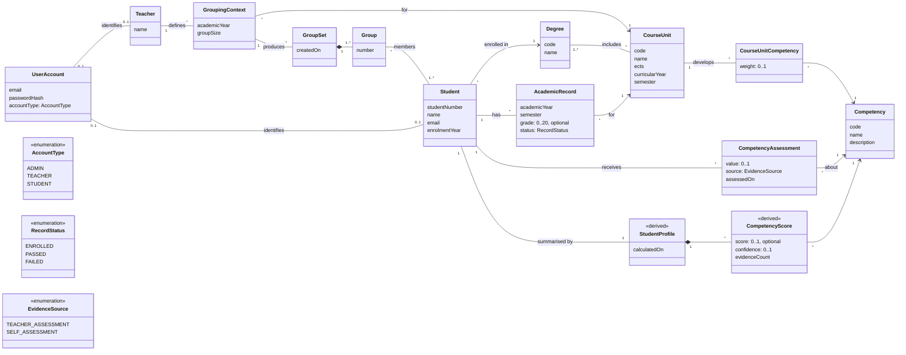

# StudyMatch Domain Model

This model represents the concepts of the StudyMatch problem, as found in the
[use cases](../use-cases.md). It describes the domain, not the implementation:
controllers, repositories and database tables are not shown. Code names follow the
term table in [conventions.md](../conventions.md).

It replaces the first sketch in this folder (`initial-domain-model-concept-diagram.png`),
which did not yet include academic history, profiles, cold start or group sets.

## Class diagram

## Concepts

| Concept | Description |
|---|---|
| **UserAccount** | Credentials used to log in. Its `AccountType` (Admin, Teacher, Student) defines which features the user can access. Administrators only exist as accounts. |
| **Teacher** | Academic staff member who registers academic information and forms groups. |
| **Student** | A student of a degree. Identified by a unique student number. |
| **Degree** | A degree programme (e.g. "Engenharia Informática"). |
| **CourseUnit** | A course unit (cadeira) of one or more degrees, with its ECTS credits and position in the curriculum. |
| **Competency** | Something a student can be good at (e.g. Programming, Databases, Problem Solving). Competencies are data, not hard-coded, so new ones can be added. |
| **CourseUnitCompetency** | States how much a course unit develops a competency (`weight` from 0 to 1). This is how grades are turned into competencies. |
| **AcademicRecord** | One attempt of a student at a course unit in a given academic year and semester. A student can have several records for the same course unit (failed and repeated, or grade improvement). The grade is empty while the student is still enrolled. |
| **CompetencyAssessment** | Evidence about a competency that does not come from grades: an estimate made by a teacher or by the student. Used for the cold start. |
| **StudentProfile** *(derived)* | The current summary of a student: one `CompetencyScore` per competency. It is calculated from academic records and assessments, not entered by hand, so it is always up to date. |
| **CompetencyScore** *(derived)* | The student's level in one competency (0 to 1), how much evidence supports it (`evidenceCount`) and how reliable it is (`confidence`). When there is no evidence at all, the score is unknown rather than 0. |
| **GroupingContext** | The situation in which groups are formed: a course unit, an academic year and a target group size. |
| **GroupSet** | One result of forming groups for a grouping context. It can be exported. |
| **Group** | A numbered group of students within a group set. |

## Relationships and constraints

1. A student number and an email are unique.
2. A course unit belongs to at least one degree, and its code is unique.
3. A course-unit competency weight is between 0 and 1. A course unit cannot be linked
   to the same competency twice.
4. A grade is between 0 and 20. A record with status `PASSED` has a grade of at least 10;
   a record with status `FAILED` has a grade below 10; a record with status `ENROLLED`
   has no grade.
5. A student cannot have two records for the same course unit in the same academic
   year and semester.
6. An assessment value is between 0 and 1. A teacher assessment is considered more
   reliable than a self-assessment.
7. A competency score is calculated only from evidence linked to that competency.
   The more academic evidence exists, the less the cold-start assessments count.
8. A group size is at least 2 and at most the number of students in the grouping
   context.
9. Only students with an academic record for the context's course unit in the context's
   academic year can be placed in its groups.
10. Within a group set, each student belongs to exactly one group.

## How the model supports the open problems

- **Academic history:** `AcademicRecord` stores every attempt, so the history shows
  progression, failures and improvements over time.
- **Profiles:** `CourseUnitCompetency` connects grades to competencies, and
  `StudentProfile` is derived from them, which makes it possible to explain which grades
  contributed to each competency.
- **Cold start:** `CompetencyAssessment` gives first-year students an initial profile.
  `CompetencyScore.confidence` shows how much the score can be trusted, and
  academic evidence gradually takes over as it becomes available. The exact formula is a
  Sprint 2 decision.
- **Matching:** `GroupingContext`, `GroupSet` and `Group` give the future
  group-formation algorithm a place to read its input and store its result.
